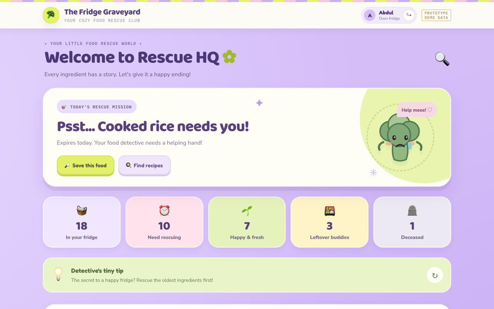
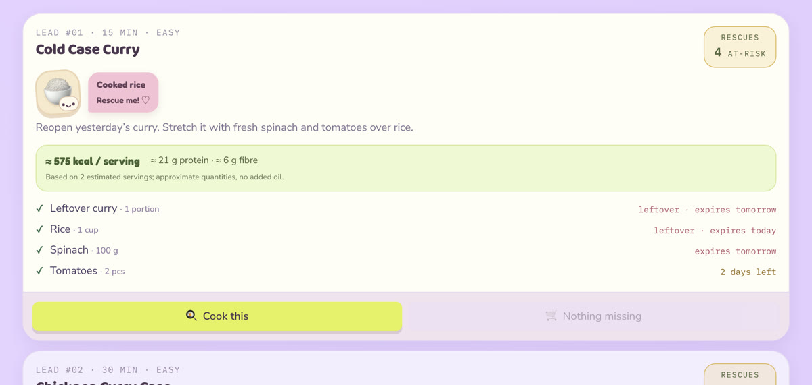
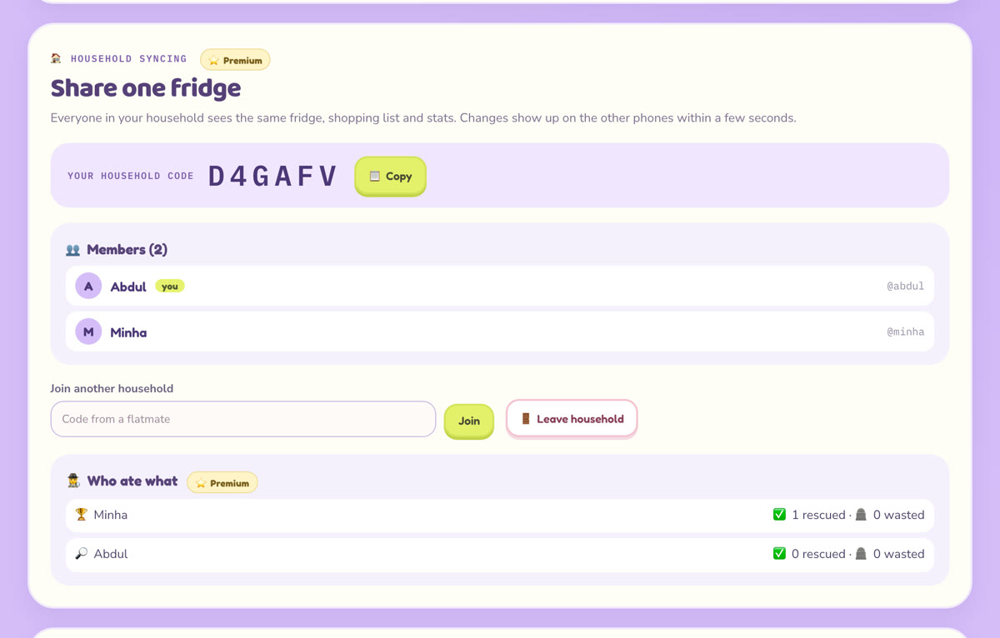
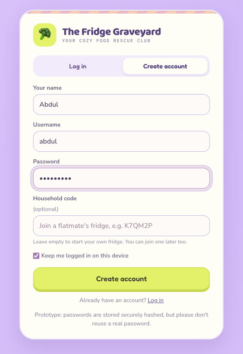
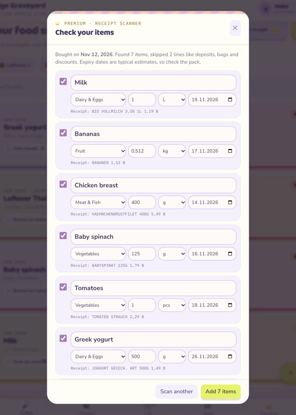

<div align="center">

# 🥦 The Fridge Graveyard

**Rescue your groceries before they become a cold case.**

A playful food-waste app for students and shared flats: track what's in your fridge, see what expires first,
cook recipes that use it up, and share one fridge with your flatmates.




</div>

---

## ✨ What it does

| | Feature | What you get |
|---|---|---|
| 🧊 | **Expiry-first fridge** | Every item sorted by what expires first, with a daily "rescue mission" and a suggested action: eat, freeze, cook or toss. |
| 🧾 | **Receipt scanner** | Snap a grocery receipt and the food adds itself, with estimated expiry dates. Deposits, bags and discounts are skipped. |
| 🍳 | **Rescue recipes** | 32 recipes ranked by how much at-risk food they use, with quantities, what's missing, and a nutrition estimate. |
| 🥗 | **Food goals** | Diet (vegetarian, vegan, halal…), allergies, favourite and disliked ingredients, protein and fibre goals. |
| 🗓️ | **Weekly meal planner** | Seven dinners planned around expiry dates, plus one shopping list for the week. |
| 🛒 | **Shopping list** | Missing ingredients land here automatically, and you can tick them off in the shop. |
| 🏠 | **Shared households** | Flatmates join with a 6-character code and share one fridge. Changes sync to everyone within seconds. |
| 🕵️ | **Who ate what** | Every rescued or wasted item records who closed it, with a household scoreboard. |
| 📊 | **Stats** | Rescue rate, items saved and wasted, and an estimate of the money you saved. |
| 🔐 | **Accounts** | Log in with a username and password. Passwords are stored as salted hashes, never in plain text. |

> ⭐ **Premium** is shown as a free 7-day trial, then €5 a month. This is a prototype, so the price is for demo only and no real payment is ever taken.

<p align="center">
  
  
</p>
<p align="center">
  
  &nbsp;&nbsp;
  
</p>

---

## 🚀 Run it locally

You need **Python 3.10 or newer**. On a Mac the built-in `python3` is 3.9, so install a newer one first, for example `brew install python@3.12`.

```bash
python3.12 -m venv .venv
source .venv/bin/activate
pip install -r requirements.txt
uvicorn backend.main:app --reload
```

Then open **http://localhost:8000** and create an account. The interactive API docs are at http://localhost:8000/docs.

> 💡 If port 8000 is already in use, add `--port 8001` and open http://localhost:8001 instead.

### 👥 Try it with two people on one computer

1. **Normal browser window:** create an account (e.g. *Abdul*), open the **Premium** tab and copy the household code.
2. **Incognito window:** create a second account (e.g. *Minha*) and paste the code into **Household code**.
3. Mark an item as eaten in one window. Within a few seconds the other window shows *"Minha updated the fridge"* and the item disappears.
4. Open **Who ate what** on the Premium tab to see who rescued what.

Use a normal and an incognito window (or two different browsers), because two tabs of the same window share one login.

---

## 🧱 How it's built

```
frontend/index.html    React 18 + Tailwind app (single file, compiled in the browser)
backend/main.py        FastAPI server: serves the app and the /api endpoints
backend/auth.py        accounts, password hashing and login sessions
backend/receipts.py    turns receipt text into food items (German/English food dictionary)
backend/fridge.db      SQLite database, created automatically on first run (not committed)
tests/                 pytest suite for the API and the receipt reader
docs/                  research documents and screenshots
```

- **Households:** every account belongs to a household, and the household owns the fridge, shopping list, goals and stats.
- **Live sync:** each phone checks for changes every few seconds. If two people save at the same moment, the later save is rejected instead of silently overwriting the other person's change.
- **Receipt scanning:** the photo is read on your device with [Tesseract.js](https://tesseract.projectnaptha.com/) (free and open source) and never uploaded. Only the recognised text goes to the Python backend.

<details>
<summary><b>📡 API reference</b></summary>

All data endpoints need a login: send `Authorization: Bearer <token>` from `/api/auth/login` or `/api/auth/register`.

| Method | Path                       | What it does                                                 |
|--------|----------------------------|--------------------------------------------------------------|
| POST   | `/api/auth/register`       | Create an account (optionally joining a household by code)   |
| POST   | `/api/auth/login`          | Log in, returns a session token                              |
| POST   | `/api/auth/logout`         | End the session                                              |
| GET    | `/api/auth/me`             | Current user, household code and members                     |
| GET    | `/api/households/{code}`   | Preview a household before joining (members, item count)     |
| POST   | `/api/household/join`      | Join a household by code                                     |
| POST   | `/api/household/leave`     | Leave and start a fresh household                            |
| GET    | `/api/state`               | Load the household's state, version and who saved it last    |
| PUT    | `/api/state`               | Save the state (`X-Base-Version` guards against overwrites)  |
| DELETE | `/api/state`               | Wipe this household's state (the app reloads demo data)      |
| GET    | `/api/items`               | List fridge items                                            |
| GET    | `/api/shopping`            | List the shopping list                                       |
| GET    | `/api/stats`               | Rescued and wasted stats                                     |
| GET    | `/api/stats/members`       | Who-ate-what scoreboard for every household member           |
| POST   | `/api/receipts/parse`      | Turn receipt text into food items                            |

</details>

### 🧪 Tests

```bash
pip install -r requirements-dev.txt
pytest
```

The tests use a temporary database, so your own `fridge.db` is never touched.

---

## 👩‍💻 Team

| Role | Name | Focus |
|---|---|---|
| 🧭 Project Manager | **Abdul Muhaimin Khan** | Scope, coordination, GitHub workflow and integration |
| 🔬 Product / Research Lead | **Jaclyn Grace Christy** | Competitor research, feature ranking, implementation prompts |
| 🎨 UX/UI Lead | **Minha Ashehad Faizy** | Visual design, rescue flow, mascots, usability |
| 🧪 Development + Quality / Media Lead | **Prathibha Prasanth** | Backend logic, bug fixes, testing |

We worked through GitHub issues (one per role), feature branches and reviewed pull requests.

<div align="center">

**Less waste. More rescues.** 🥦

<sub>Built for the Computer and Media Lab course, semester 4. All data shown in the app and screenshots is fictional demo data.</sub>

</div>
